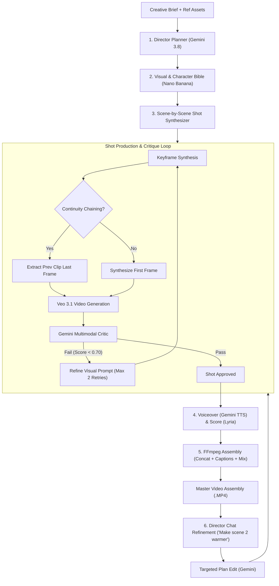
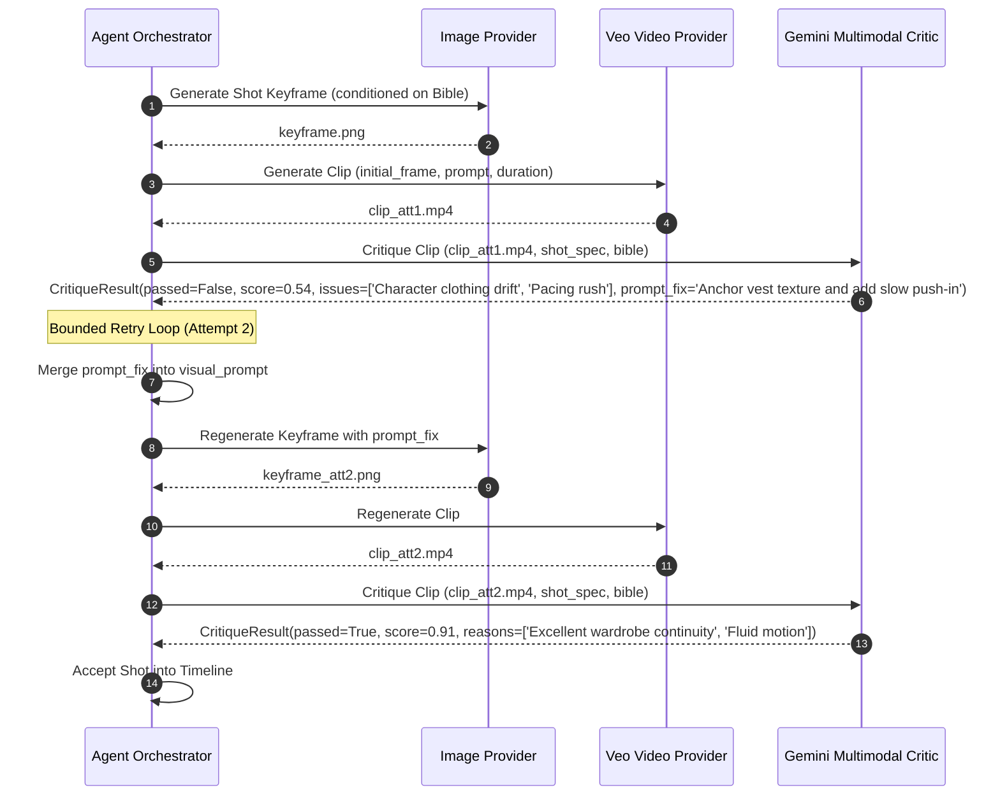
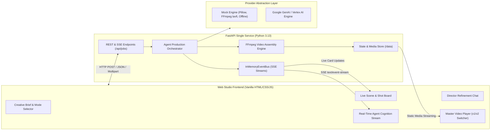

# Showrunner AI 🎬

> **The Agentic AI Video Studio — "Antigravity for Video Production"**  
> *Submitted to the Google Cloud AI Builder Cup 2026 by Hamza Nadeem & Urooj Nadeem.*

[](LICENSE)
[](https://www.python.org/)
[](https://fastapi.tiangolo.com/)
[](https://cloud.google.com/vertex-ai)

Showrunner AI is an autonomous, agentic AI video production studio. It transforms a single creative brief (and optional reference images) into a fully assembled, broadcast-ready film with continuous camera movement, visual consistency, professional voiceover, ducked soundtrack, burned-in subtitles, and targeted scene-level chat refinement.

---

## ⚡ The Agent Loop

Traditional generative video tools generate disjointed clips from independent prompts. Showrunner AI operates as an end-to-end autonomous agent with an explicit multi-stage production pipeline:



### 1. Planning & Pacing (Gemini 3.8 Flash)
The agent synthesizes a cohesive screenplay, scene-by-scene narrative arcs, duration-snapped shot lists (4s, 6s, 8s for Veo), camera directions, voiceover scripts, and character/product definitions.

### 2. Visual & Character Bible (Nano Banana / Gemini Image)
To enforce strict visual fidelity, the agent generates dedicated character and product reference sheets. Every subsequent keyframe is grounded against this locked visual bible.

### 3. Continuity Chaining (Last-Frame to First-Frame)
When consecutive shots share continuous motion within a scene, the orchestrator automatically uses **FFmpeg** to extract the exact last frame of shot $k$ and injects it as the starting frame for shot $k+1$. This eliminates jarring jump cuts and produces continuous physical motion.

### 4. Video Synthesis (Veo 3.1 Image-to-Video)
Each shot is animated using Google's Veo 3.1 image-to-video foundation model (`veo-3.1-fast-generate-001` on Vertex AI), honoring 16:9 720p framing and explicit camera motion directives.

### 5. Multimodal Critic Loop (Gemini Vision)
Before any clip reaches the final timeline, the Gemini Multimodal Critic inspects it against the shot specifications and visual bible. If artifacts, character drift, or pacing discrepancies are identified, the critic issues concrete prompt corrections and triggers an automated reshoot (bounded by `MAX_RETRIES`).



### 6. Sound Design & Master FFmpeg Assembly
- **Voiceover**: Gemini TTS (`gemini-3.8-flash-tts`) synthesizes naturalistic spoken voiceover paced to shot durations.
- **Score**: DeepMind Lyria (`lyria-3-clip-preview` / `lyria-3.5`) synthesizes atmospheric background music.
- **FFmpeg Engine**: Concat demuxer joins clips with transition buffers, burns high-contrast subtitles, and dynamically ducks background music during active voiceover lines.

### 7. Director Chat Refinement
The production process doesn't end with the first cut. Directors can issue natural language feedback (e.g. *"Make scene 2 warmer and more dramatic"* or *"Rewrite the dialogue in shot 1 to 'Unleash infinite momentum'"*). The agent:
- Identifies **only** the affected shots and scenes.
- Propagates continuity chaining for any follow-up shots in the same scene.
- Re-synthesizes voiceover if lines change.
- Re-shoots only affected clips through the critic loop, reusing all unchanged media from disk.
- Assembles a versioned cut (`final_v2.mp4`) with an instant version switcher in the UI.

---

## 🤖 Google Models & Services

| Pipeline Role | Model ID | Environment Variable | API Surface |
| :--- | :--- | :--- | :--- |
| **Director & Screenplay Planner** | `gemini-3.8-flash` | `SR_MODEL_PLANNER` | Google GenAI SDK (`generate_content` + `response_schema`) |
| **Multimodal Video Critic** | `gemini-3.8-flash` | `SR_MODEL_CRITIC` | Google GenAI SDK (`generate_content` multimodal video) |
| **Visual Bible & Keyframes** | `gemini-3.1-flash-image` | `SR_MODEL_IMAGE` | Google GenAI SDK (`generate_content` image modalities) |
| **Cinematic Video Generation** | `veo-3.1-fast-generate-001` | `SR_MODEL_VIDEO` | Google GenAI SDK (`generate_videos` image-to-video) |
| **Spoken Voiceover Synthesis** | `gemini-3.8-flash-tts` | `SR_MODEL_TTS` | Interactions API (`speech_metadata`) |
| **Soundtrack & Score** | `lyria-3-clip-preview` / `lyria-3.5` | `SR_MODEL_MUSIC` | DeepMind Lyria Music API |

---

## 🏛 System Architecture

Showrunner AI is structured as a single self-contained FastAPI service serving both REST/SSE APIs and a zero-build reactive Web Studio frontend:



---

## 🛠 Provider Modes & Modality Overrides

Showrunner AI is configured via `SHOWRUNNER_PROVIDER`:
- `SHOWRUNNER_PROVIDER=mock`: Complete zero-cost offline mock engine utilizing Pillow for keyframes, FFmpeg Ken-Burns zoompan for clips, and synthetic WAV synthesis.
- `SHOWRUNNER_PROVIDER=google`: Full Google Cloud production pipeline using Gemini 3.8, Veo 3.1, and Lyria. Supports both standard Gemini API Keys and Vertex AI with Workload Identity on Google Cloud.
- **Hybrid Modality Overrides**: You can run any combination of real and mock providers simultaneously:
  ```bash
  SHOWRUNNER_PROVIDER=mock
  SR_PROVIDER_PLANNER=google    # Use real Gemini 3.8 for planning
  SR_PROVIDER_CRITIC=google     # Use real Gemini 3.8 for multimodal review
  SR_PROVIDER_VIDEO=mock        # Use mock video to conserve generation quotas
  ```

---

## 🚀 Local Quickstart

### Prerequisites
- Python 3.13+
- FFmpeg 6.0+ (`sudo apt install ffmpeg fonts-dejavu-core`)

### Installation & Run

1. **Clone the repository**:
   ```bash
   git clone https://github.com/your-org/showrunner-ai.git
   cd showrunner-ai
   ```

2. **Create and activate virtual environment**:
   ```bash
   python3 -m venv .venv
   source .venv/bin/activate
   pip install -r requirements-dev.txt
   ```

3. **Configure environment**:
   ```bash
   cp .env.example .env
   # Edit .env to add your GEMINI_API_KEY if testing live Google providers
   ```

4. **Run the local development server**:
   ```bash
   uvicorn app.main:app --host 0.0.0.0 --port 8080 --reload
   ```
   Open your browser to [http://localhost:8080](http://localhost:8080).

5. **Run the automated test suite**:
   ```bash
   pytest -v
   ```

---

## ☁️ Google Cloud Run Deployment

Showrunner AI is packaged to run on **Google Cloud Run** with persistent Cloud Storage FUSE mounting:

> [!IMPORTANT]
> **Cloud Run Architecture Requirement**:  
> Because jobs run in-process as asyncio background tasks with an in-memory event bus, `--max-instances=1` and `--no-cpu-throttling` are required. State persists to `DATA_DIR` via Cloud Storage FUSE (`/data`), ensuring that `job.json`, keyframes, clips, audio, and master video files survive container restarts.

### Restarts & Failure Handling

- On startup, jobs left mid-flight by a previous process are marked `failed` ("Interrupted by server restart"); interrupted chat refinements fall back to the last completed version. Failed jobs show a **Resume production** button (`POST /api/jobs/{id}/resume`).
- Each shot retries provider errors, then accepts its best-scoring clip; only a shot with no usable clip fails the job, and sibling scenes are cancelled immediately to avoid further paid renders.
- The Veo operation id is persisted on each shot (`veo_operation_name`); the Veo launch call is never auto-retried (no duplicate paid jobs). Only 5xx and 429 errors are retried, with jittered backoff.
- `job.json` is written atomically (temp file + `os.replace`).

### Demo Access Control

The public service is protected by a shared demo token so strangers cannot start paid Veo jobs:

| Variable | Default | Purpose |
| --- | --- | --- |
| `DEMO_TOKEN` | unset (no auth, local dev) | Required on `POST /api/jobs` and `POST /api/jobs/{id}/chat` via the `X-Demo-Token` header (or `?token=`). The web UI prompts once and stores it in `localStorage`. `scripts/deploy.sh` generates one if not provided and prints it. |
| `MAX_JOBS_PER_DAY` | `0` locally, `20` in `deploy.sh` | Cap on new productions + chat refinements per UTC day (`429` when exceeded). |
| `CORS_ORIGINS` | `*` | Allowed origins; credentials are never allowed cross-origin. |

Uploaded reference images are restricted to PNG/JPG/WEBP (magic-byte checked, max 5 files x 10 MB) and stored under server-generated UUID filenames.

### Automated Deployment

Run the included deployment script:

```bash
export PROJECT_ID="your-gcp-project-id"
export REGION="us-central1"

# Deploy using Vertex AI Service Account mode (Recommended):
./scripts/deploy.sh

# Or deploy in DEMO_MOCK mode (zero model cost):
DEMO_MOCK=1 ./scripts/deploy.sh

# Or deploy with an API Key stored in Google Secret Manager:
MODE=apikey GEMINI_API_KEY="your-key" ./scripts/deploy.sh
```

---

## 📡 API Reference

| Method | Endpoint | Description |
| :--- | :--- | :--- |
| `GET` | `/` | Serves the Showrunner Web Studio interface |
| `GET` | `/api/health` | Service health, active provider configuration, and model IDs |
| `GET` | `/api/jobs` | Lists recent productions with metadata and poster previews |
| `POST` | `/api/jobs` | Registers a new creative brief (JSON or multipart with ref images) |
| `GET` | `/api/jobs/{id}` | Retrieves full state, scene specifications, shot attempts, and media URLs |
| `GET` | `/api/jobs/{id}/events` | Live Server-Sent Events (SSE) stream of agent cognition logs |
| `POST` | `/api/jobs/{id}/chat` | Submits director instructions to refine a scene (409 if busy) |
| `POST` | `/api/jobs/{id}/resume` | Resumes a failed/interrupted production, reusing sheets, audio and accepted shots |
| `GET` | `/media/{path:path}` | Serves rendered production assets from `DATA_DIR` |

---

## 📂 Project Structure

```text
showrunner-ai/
├── app/
│   ├── config.py                 # Pydantic settings & environment configuration
│   ├── events.py                 # In-memory SSE event bus for agent logs
│   ├── main.py                   # FastAPI service & REST endpoints
│   ├── models.py                 # Pydantic data schemas (Job, Plan, Shot, Bible)
│   ├── pipeline/
│   │   ├── assembler.py          # FFmpeg master concatenation & audio ducking
│   │   └── orchestrator.py       # Agent orchestrator & chat refinement loop
│   └── providers/
│       ├── base.py               # Abstract provider interfaces
│       ├── factory.py            # Provider resolution & hybrid overrides
│       ├── mock.py               # Deterministic brief-aware mock engine
│       └── google/
│           ├── client.py         # Google GenAI SDK client factory & retry backoff
│           ├── critic.py         # Gemini multimodal video critic
│           ├── image.py          # Gemini image & reference sheet provider
│           ├── music.py          # DeepMind Lyria score provider
│           ├── planner.py        # Gemini structured screenplay & edit planner
│           ├── tts.py            # Gemini speech & audio synthesis
│           └── video.py          # Veo 3.1 image-to-video provider
├── scripts/
│   ├── deploy.sh                 # Cloud Run deployment script
│   └── smoke_google.py           # Provider connectivity validation script
├── static/
│   ├── app.js                    # Reactive Web Studio controller & SSE consumer
│   ├── index.html                # 3-column studio interface
│   └── style.css                 # Dark-mode cinematic aesthetic stylesheet
├── tests/
│   ├── test_api.py               # REST API & SSE streaming tests
│   ├── test_google_media_providers.py  # Mocked Veo, TTS, Lyria provider tests
│   ├── test_google_planner_critic.py   # Mocked Gemini planner & critic tests
│   ├── test_google_providers.py        # Comprehensive Google provider unit tests
│   ├── test_pipeline.py          # End-to-end assembly & critic loop tests
│   ├── test_planner.py           # Brief awareness & duration snapping tests
│   └── test_refinement.py        # Targeted shot refinement & chat tests
├── .dockerignore                 # Docker build exclusions
├── .env.example                  # Environment variable blueprint
├── Dockerfile                    # Container definition for Cloud Run
├── LICENSE                       # MIT License
├── README.md                     # Studio documentation & architecture guide
├── requirements.txt              # Production Python dependencies
└── requirements-dev.txt          # Development & pytest dependencies
```

---

## 🗺 Limitations & Future Roadmap

- **Multi-Worker Cloud Scaling**: Currently optimized for single-worker execution (`--max-instances=1`) due to in-memory event buses. A future revision will migrate the event bus to Google Cloud Pub/Sub and task orchestration to Cloud Tasks.
- **Ultra-HD 4K Upscaling**: Integrating Google Imagen Super-Resolution models to upscale generated 720p/1080p clips to broadcast 4K HDR.
- **Custom Voice Cloning**: Permitting producers to upload reference voice samples for automated director voiceover matching via Gemini Voice cloning.

---

## 👥 Authors & Acknowledgements

Created with ❤️ by:
- **Hamza Nadeem**
- **Urooj Nadeem**

Submitted for the **Google Cloud AI Builder Cup 2026**. Built with Google Cloud Vertex AI, Gemini 3.8, Veo 3.1, and DeepMind Lyria.

---

## 📄 License

This project is licensed under the MIT License — see the [LICENSE](LICENSE) file for details.
