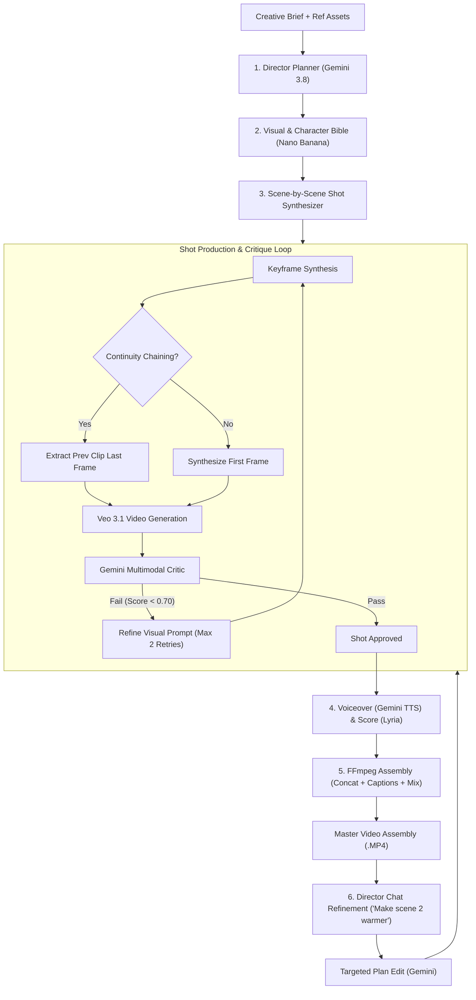
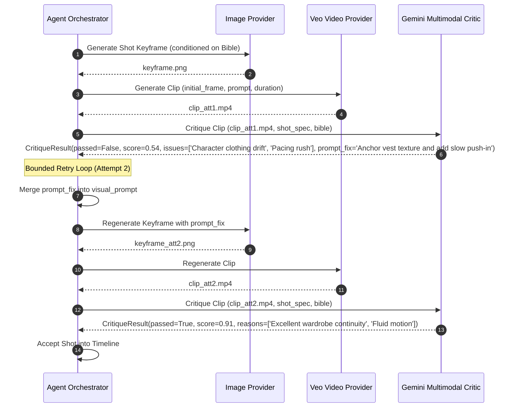
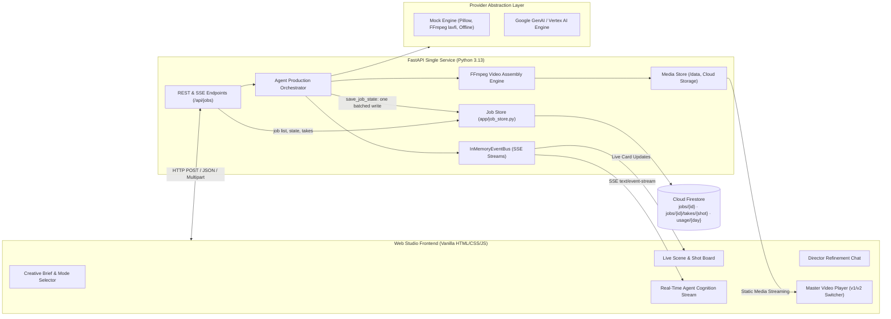
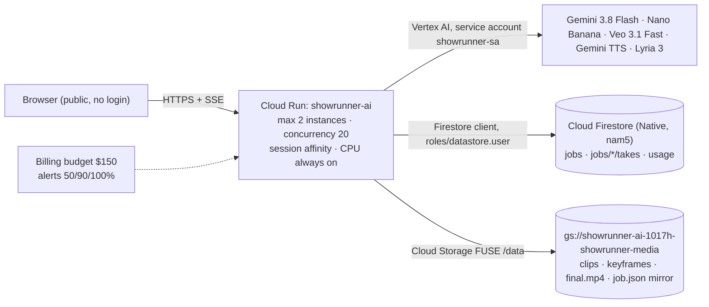

# Showrunner AI 🎬

> **The Agentic AI Video Studio — "Antigravity for Video Production"**  
> *Submitted to the Google Cloud AI Builder Cup 2026 by Hamza Nadeem & Urooj Nadeem.*

[](LICENSE)
[](https://www.python.org/)
[](https://fastapi.tiangolo.com/)
[](https://cloud.google.com/vertex-ai)

### 🔴 Live demo: **[https://showrunner-ai-jdakbjo4ea-uc.a.run.app](https://showrunner-ai-jdakbjo4ea-uc.a.run.app)**
Open it, browse the **sample gallery** (a real 30s ad and a real ~2.5 min short film made end-to-end by the agent), or type a brief to start your own tiny production. There's no login. Public jobs are capped to keep costs safe (see [Public demo limits](#public-demo-limits)).

Showrunner AI is an autonomous, agentic AI video production studio. It transforms a single creative brief (and optional reference images) into a fully assembled, broadcast-ready film with continuous camera movement, visual consistency, professional voiceover, ducked soundtrack, burned-in subtitles, and targeted scene-level chat refinement.

---

## ⚡ The Agent Loop

Traditional generative video tools generate disjointed clips from independent prompts. Showrunner AI operates as an end-to-end autonomous agent with an explicit multi-stage production pipeline:



### 1. Planning & Pacing (Gemini 3.8 Flash)
The agent synthesizes a cohesive screenplay, scene-by-scene narrative arcs, duration-snapped shot lists (4s, 6s, 8s for Veo), camera directions, voiceover scripts, and character/product definitions.

### 2. Visual & Character Bible (Nano Banana / Gemini Image)
To enforce strict visual fidelity, the agent generates dedicated character and product reference sheets. Every subsequent keyframe is grounded against this locked visual bible.

### 3. Continuity Chaining (Last-Frame to First-Frame)
When consecutive shots share continuous motion within a scene, the orchestrator automatically uses **FFmpeg** to extract the exact last frame of shot $k$ and injects it as the starting frame for shot $k+1$. This eliminates jarring jump cuts and produces continuous physical motion.

### 4. Video Synthesis (Veo 3.1 Image-to-Video)
Each shot is animated using Google's Veo 3.1 image-to-video foundation model (`veo-3.1-fast-generate-001` on Vertex AI), honoring 16:9 720p framing and explicit camera motion directives.

### 5. Multimodal Critic Loop (Gemini Vision)
Before any clip reaches the final timeline, the Gemini Multimodal Critic inspects it against the shot specifications and visual bible. If artifacts, character drift, or pacing discrepancies are identified, the critic issues concrete prompt corrections and triggers an automated reshoot (bounded by `MAX_RETRIES`).



### 6. Sound Design & Master FFmpeg Assembly
- **Voiceover**: Gemini TTS (`gemini-3.8-flash-tts`) synthesizes naturalistic spoken voiceover paced to shot durations.
- **Score**: DeepMind Lyria (`lyria-3-clip-preview` / `lyria-3-pro-preview`) synthesizes atmospheric background music.
- **FFmpeg Engine**: Concat demuxer joins clips with transition buffers, burns high-contrast subtitles, and dynamically ducks background music during active voiceover lines.

### 7. Director Chat Refinement
The production process doesn't end with the first cut. Directors can issue natural language feedback (e.g. *"Make scene 2 warmer and more dramatic"* or *"Rewrite the dialogue in shot 1 to 'Unleash infinite momentum'"*). The agent:
- Identifies **only** the affected shots and scenes.
- Propagates continuity chaining for any follow-up shots in the same scene.
- Re-synthesizes voiceover if lines change.
- Re-shoots only affected clips through the critic loop, reusing all unchanged media from disk.
- Assembles a versioned cut (`final_v2.mp4`) with an instant version switcher in the UI.

---

## 🖥 The Agent Workspace

The web UI works like a coding-agent workspace (Claude Code / Antigravity style), but for film:

- **Agent thread (left)**: the director agent narrates the run as chat messages and tool cards. You see the plan (scenes and shot list), the visual bible (palette and character/product sheets), and every shot's takes with the critic verdict. A typical shot reads *Take 1 rejected (0.46): floating ring of fire → correction applied → Take 2 (0.74) accepted*. Then soundtrack and voiceover, the master cut, and director-chat refinements, which list the shots they will regenerate. Messages stream live over SSE; for finished jobs and read-only samples the thread is rebuilt from saved job state.
- **Stage (centre)**: a large player (final cut, or the selected shot's take), run stats (takes, reshoots, average critic score), and a filmstrip timeline grouped by scene, with per-shot status: rendering, passed, best-of-N (flagged) or queued.
- **Inspector (right, collapsible)**: the selected shot's action, camera, voiceover, final Veo prompt and all takes side by side with scores, reasons and corrections, plus the style bible.
- Light theme by default; dark theme via the sun/moon toggle (saved in `localStorage`). Vanilla JS, no build step.

---

## 🤖 Google Models & Services

| Pipeline Role | Model ID | Environment Variable | API Surface |
| :--- | :--- | :--- | :--- |
| **Director & Screenplay Planner** | `gemini-3.8-flash` | `SR_MODEL_PLANNER` | Google GenAI SDK (`generate_content` + `response_schema`) |
| **Multimodal Video Critic** | `gemini-3.8-flash` | `SR_MODEL_CRITIC` | Google GenAI SDK (`generate_content` multimodal video) |
| **Visual Bible & Keyframes** | `gemini-3.1-flash-image` | `SR_MODEL_IMAGE` | Google GenAI SDK (`generate_content` image modalities) |
| **Cinematic Video Generation** | `veo-3.1-fast-generate-001` | `SR_MODEL_VIDEO` | Google GenAI SDK (`generate_videos` image-to-video) |
| **Spoken Voiceover Synthesis** | `gemini-3.8-flash-tts` | `SR_MODEL_TTS` | `generate_content` audio modality on Vertex (Interactions API on AI Studio) |
| **Soundtrack & Score (≤30s)** | `lyria-3-clip-preview` | `SR_MODEL_MUSIC` | Interactions API (Vertex, `global`) |
| **Soundtrack & Score (>30s, up to 180s)** | `lyria-3-pro-preview` | `SR_MODEL_MUSIC_LONG` | Interactions API (Vertex, `global`) |
| **Keyframe fallback on 429** | `gemini-2.5-flash-image` | `SR_MODEL_IMAGE_FALLBACK` | `generate_content` image modality |
| **Job state, job list & usage counters** | Cloud Firestore (Native, `nam5`) on a Firebase project | `SR_JOB_STORE=firestore` | `google-cloud-firestore` (batched writes, transactions) |
| **Media (keyframes, clips, VO, score, final cuts)** | Cloud Storage | `DATA_DIR=/data` | Cloud Storage FUSE volume on Cloud Run |
| **Hosting** | Cloud Run | `scripts/deploy.sh` | Container built with Cloud Build |

Veo runs in `us-central1` at 720p (`generate_audio=False`; VO and score are generated separately). Gemini, Nano Banana, TTS and Lyria run on the Vertex `global` endpoint.

---

## 🏛 System Architecture

Showrunner AI is structured as a single self-contained FastAPI service serving both REST/SSE APIs and a zero-build reactive Web Studio frontend:



---

## 🛠 Provider Modes & Modality Overrides

Showrunner AI is configured via `SHOWRUNNER_PROVIDER`:
- `SHOWRUNNER_PROVIDER=mock`: Complete zero-cost offline mock engine utilizing Pillow for keyframes, FFmpeg Ken-Burns zoompan for clips, and synthetic WAV synthesis.
- `SHOWRUNNER_PROVIDER=google`: Full Google Cloud production pipeline using Gemini 3.8, Veo 3.1, and Lyria. Supports both standard Gemini API Keys and Vertex AI with Workload Identity on Google Cloud.
- **Hybrid Modality Overrides**: You can run any combination of real and mock providers simultaneously:
  ```bash
  SHOWRUNNER_PROVIDER=mock
  SR_PROVIDER_PLANNER=google    # Use real Gemini 3.8 for planning
  SR_PROVIDER_CRITIC=google     # Use real Gemini 3.8 for multimodal review
  SR_PROVIDER_VIDEO=mock        # Use mock video to conserve generation quotas
  ```

---

## 🚀 Local Quickstart

### Prerequisites
- Python 3.13+
- FFmpeg 6.0+ (`sudo apt install ffmpeg fonts-dejavu-core`)

### Installation & Run

1. **Clone the repository**:
   ```bash
   git clone https://github.com/iamhamzanadeem/showrunner-ai.git
   cd showrunner-ai
   ```

2. **Create and activate virtual environment**:
   ```bash
   python3 -m venv .venv
   source .venv/bin/activate
   pip install -r requirements-dev.txt
   ```

3. **Configure environment**:
   ```bash
   cp .env.example .env
   # Mock mode works out of the box. For real models, either set GEMINI_API_KEY,
   # or use Vertex: GOOGLE_GENAI_USE_VERTEXAI=true, GOOGLE_CLOUD_PROJECT=..., 
   # SHOWRUNNER_PROVIDER=google (and run `gcloud auth application-default login`)
   ```

4. **Run the local development server**:
   ```bash
   uvicorn app.main:app --host 0.0.0.0 --port 8080 --reload
   ```
   Open your browser to [http://localhost:8080](http://localhost:8080).

5. **Run the automated test suite**:
   ```bash
   pytest -v   # always runs in mock mode, no billable calls
   ```

---

## ☁️ Google Cloud Run Deployment

Showrunner AI is packaged to run on **Google Cloud Run** with persistent Cloud Storage FUSE mounting:



- **Runtime**: one FastAPI container serving the UI, REST and SSE. Jobs run in-process as asyncio tasks, so `--no-cpu-throttling` is set.
- **Job state (Firestore)**: with `SR_JOB_STORE=firestore` (set by `deploy.sh`), Cloud Firestore is the source of truth for job state, the sidebar/gallery job list and the daily usage counters. The project is also registered as a Firebase project.
  - `jobs/{job_id}` holds the summary fields the sidebar lists (title, logline, status, mode, runtime, scene/shot/take counts, reshoots, average critic score, versions, timestamps) plus `state`: the full job (brief, plan, style bible, shots, versions, chat, Veo operation ids) minus the take history.
  - `jobs/{job_id}/takes/{shot_id}` holds every take of that shot (prompt, keyframe, clip, critic score, reasons, correction). Takes live in a subcollection so the job document stays far below the 1 MiB limit.
  - Every `save_job_state` writes the job document and the changed takes documents in one atomic batch. Unchanged takes are not rewritten.
  - `usage/{YYYY-MM-DD}` holds `total` plus hashed per-IP counts, checked and incremented in a Firestore transaction, so the caps hold across both instances.
  - `scripts/backfill_firestore.py` imports existing `job.json` files. Locally and in tests, `SR_JOB_STORE=file` (the default) keeps everything in `DATA_DIR`.
- **Media storage**: `DATA_DIR=/data` is a GCS FUSE mount for keyframes, clips, audio and finished films. `job.json` is still written there as a mirror and is read only for jobs that have no Firestore document.
- **Scaling**: at most 2 instances (`--max-instances=2`, concurrency 20). The event bus is in-memory per instance, so `--session-affinity` keeps a browser on the instance running its job. If a request lands on the other instance, it reads job state from the bucket. A job is only treated as interrupted (and made resumable) once it has had no update for `RECOVERY_STALE_S` (20 min), so a new instance never fails its sibling's live job.
- **Identity**: dedicated service account `showrunner-sa` with only `roles/aiplatform.user` and `roles/datastore.user` (project) and `roles/storage.objectAdmin` (media bucket). No API keys.
- **SSE**: streams replay job history, then send keepalives every 15s. The client dedupes replayed events on reconnect.
- **Large media**: Cloud Run rejects sized HTTP/1 responses over 32 MiB. Files over 24 MB (a 2.5 min film is ~39 MB) are served in byte ranges of up to 16 MB, which video players request in sequence. Plain downloads are streamed with chunked encoding.

### Restarts & Failure Handling

- On startup, jobs left mid-flight by a previous process are marked `failed` ("Interrupted by server restart"); interrupted chat refinements fall back to the last completed version. Failed jobs show a **Resume production** button (`POST /api/jobs/{id}/resume`).
- Each shot retries provider errors, then accepts its best-scoring clip; only a shot with no usable clip fails the job, and sibling scenes are cancelled immediately to avoid further paid renders.
- The Veo operation id is persisted on each shot (`veo_operation_name`); the Veo launch call is never auto-retried (no duplicate paid jobs). Only 5xx and 429 errors are retried, with jittered backoff.
- Job state is written atomically: one Firestore batch (job document plus takes), and `job.json` via temp file + `os.replace`.

### Public demo limits

The live link is intentionally open (no password) so judges can use it. Abuse and cost protection come from caps that are all set with env vars (`scripts/deploy.sh` values shown; `0` = unlimited, the local default):

| Variable | Deployed | Purpose |
| --- | --- | --- |
| `MAX_JOBS_PER_DAY` | `60` | Global cap on new productions, chat refinements and resumes per UTC day. |
| `MAX_JOBS_PER_IP_PER_DAY` | `8` | Per-client cap. IPs are stored only as salted SHA-256 hashes (Firestore `usage/{day}`, or `usage.json` in file mode). |
| `MAX_SHOTS_PER_JOB` | `4` | The planner is told the limit, then the plan is hard-trimmed (the ending is kept). |
| `MAX_RUNTIME_S` | `30` | Max film runtime for public jobs. |
| `MAX_RETRIES` | `1` | Critic reshoots per shot. |
| `MAX_PARALLEL_SCENES` | `2` | Concurrent scene renders per job. |
| `SAMPLE_JOB_IDS` | ad + short film | Pre-rendered productions shown first in the gallery. They are read-only (no chat or resume). |
| `CORS_ORIGINS` | `*` | Allowed origins; credentials are never allowed cross-origin. |

When a cap is hit, the API returns `429` with a friendly message (e.g. *"You've used all 3 of your free AI productions for today. Please come back tomorrow (UTC) - the sample films in the gallery are always available."*), and the UI shows it as a banner. Current limits are shown under the brief box (from `/api/health`). Briefs are capped at 4000 characters. A Cloud Billing budget ($150, alerts at 50/90/100%) is set on the project as a backstop.

Uploaded reference images are restricted to PNG/JPG/WEBP (magic-byte checked, max 5 files x 10 MB) and stored under server-generated UUID filenames.

### Automated Deployment

Run the included deployment script:

```bash
export PROJECT_ID="your-gcp-project-id"
export REGION="us-central1"

# Deploy in Vertex AI mode (recommended). This creates the bucket and the
# least-privilege service account, uploads the sample jobs, and deploys:
SAMPLE_JOB_IDS="job_aedcb881dc,job_eb80955254" ./scripts/deploy.sh

# Optionally also create the $150 budget alert:
BILLING_ACCOUNT="XXXXXX-XXXXXX-XXXXXX" ./scripts/deploy.sh

# Or deploy in DEMO_MOCK mode (zero model cost):
DEMO_MOCK=1 ./scripts/deploy.sh

# Or deploy with an API Key stored in Google Secret Manager:
MODE=apikey GEMINI_API_KEY="your-key" ./scripts/deploy.sh
```

---

## 📡 API Reference

| Method | Endpoint | Description |
| :--- | :--- | :--- |
| `GET` | `/` | Serves the agent workspace UI (landing page + `/?job=<id>&shot=<shot_id>` deep links) |
| `GET` | `/api/health` | Service health, active provider configuration, and model IDs |
| `GET` | `/api/jobs` | Lists recent productions (title, logline, runtime, scene/shot/take counts, poster); samples first |
| `POST` | `/api/jobs` | Registers a new creative brief (JSON or multipart with ref images) |
| `GET` | `/api/jobs/{id}` | Retrieves full state, scene specifications, shot attempts, and media URLs |
| `GET` | `/api/jobs/{id}/takes` | Every take of every shot: keyframe, clip, critic score, reasons, correction, accepted flag |
| `GET` | `/api/jobs/{id}/events` | Live Server-Sent Events (SSE) stream of agent cognition logs |
| `POST` | `/api/jobs/{id}/chat` | Submits director instructions to refine a scene (409 if busy) |
| `POST` | `/api/jobs/{id}/resume` | Resumes a failed/interrupted production, reusing sheets, audio and accepted shots |
| `GET` | `/media/{path:path}` | Serves rendered production assets from `DATA_DIR` |

---

## 📂 Project Structure

```text
showrunner-ai/
├── app/
│   ├── config.py                 # Pydantic settings & environment configuration
│   ├── events.py                 # In-memory SSE event bus for agent logs
│   ├── job_store.py              # Job state store: Cloud Firestore or job.json files
│   ├── main.py                   # FastAPI service & REST endpoints
│   ├── models.py                 # Pydantic data schemas (Job, Plan, Shot, Bible)
│   ├── pipeline/
│   │   ├── assembler.py          # FFmpeg master concatenation & audio ducking
│   │   └── orchestrator.py       # Agent orchestrator & chat refinement loop
│   └── providers/
│       ├── base.py               # Abstract provider interfaces
│       ├── factory.py            # Provider resolution & hybrid overrides
│       ├── mock.py               # Deterministic brief-aware mock engine
│       └── google/
│           ├── client.py         # Google GenAI SDK client factory & retry backoff
│           ├── critic.py         # Gemini multimodal video critic
│           ├── image.py          # Gemini image & reference sheet provider
│           ├── music.py          # DeepMind Lyria score provider
│           ├── planner.py        # Gemini structured screenplay & edit planner
│           ├── tts.py            # Gemini speech & audio synthesis
│           └── video.py          # Veo 3.1 image-to-video provider
├── scripts/
│   ├── deploy.sh                 # Cloud Run deployment script
│   ├── backfill_firestore.py     # Import existing job.json files into Firestore
│   └── smoke_google.py           # Provider connectivity validation script
├── static/
│   ├── app.js                    # Reactive Web Studio controller & SSE consumer
│   ├── index.html                # 3-column studio interface
│   └── style.css                 # Dark-mode cinematic aesthetic stylesheet
├── tests/
│   ├── test_api.py               # REST API & SSE streaming tests
│   ├── test_google_media_providers.py  # Mocked Veo, TTS, Lyria provider tests
│   ├── test_google_planner_critic.py   # Mocked Gemini planner & critic tests
│   ├── test_google_providers.py        # Comprehensive Google provider unit tests
│   ├── test_pipeline.py          # End-to-end assembly & critic loop tests
│   ├── test_planner.py           # Brief awareness & duration snapping tests
│   └── test_refinement.py        # Targeted shot refinement & chat tests
├── .dockerignore                 # Docker build exclusions
├── .env.example                  # Environment variable blueprint
├── Dockerfile                    # Container definition for Cloud Run
├── LICENSE                       # MIT License
├── README.md                     # Studio documentation & architecture guide
├── requirements.txt              # Production Python dependencies
└── requirements-dev.txt          # Development & pytest dependencies
```

---

## 🗺 Limitations & Future Roadmap

- **Multi-Instance Scaling**: Up to 2 instances work today using session affinity and shared GCS state. Live SSE events stay on the instance running the job. A future revision will move the event bus to Pub/Sub and orchestration to Cloud Tasks.
- **Provider quirks**: Nano Banana often returns 429 under load (handled with backoff plus a fallback model). Veo sometimes refuses keyframes with realistic faces; the shot is retried text-to-video, and if it is still refused, an animated keyframe still is used and flagged in the UI.
- **Ultra-HD 4K Upscaling**: Integrating Google Imagen Super-Resolution models to upscale generated 720p/1080p clips to broadcast 4K HDR.
- **Custom Voice Cloning**: Permitting producers to upload reference voice samples for automated director voiceover matching via Gemini Voice cloning.

---

## 👥 Authors & Acknowledgements

Created with ❤️ by:
- **Hamza Nadeem**
- **Urooj Nadeem**

Submitted for the **Google Cloud AI Builder Cup 2026**. Built with Google Cloud Vertex AI, Gemini 3.8, Veo 3.1, and DeepMind Lyria.

---

## 📄 License

This project is licensed under the MIT License — see the [LICENSE](LICENSE) file for details.
